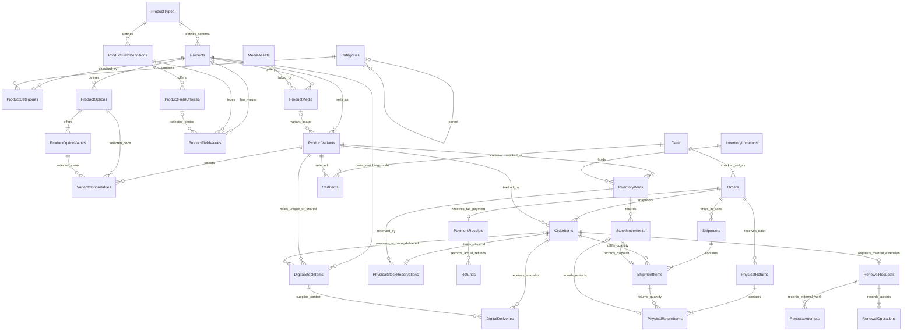

# Commerce database design

Status: Catalog/Inventory/Media/Outbox, digital stock management, [Cart/Order/reservation](features/ordering-checkout.md), [manual receipt confirmation with automatic digital delivery and email outbox](features/payment-digital-delivery.md), [physical shipping/COD](features/physical-shipping.md), [manual renewals with claims and verification](features/manual-renewals.md), and [manual refunds/physical returns](features/refunds-returns.md). Shipping was locally verified in the earlier 326-case regression; renewals were locally verified in the 398-case regression. Refund/return implementation and current verification status are tracked in its feature plan; deployment acceptance remains separate. Gateway/webhooks and carrier integration remain later slices. SQL Server and PostgreSQL share the logical model; migrations are provider-specific. One shop, whole VND amounts and one physical warehouse (`MAIN`); digital stock has a separate source. Verification and deployment status are recorded separately from implementation.

## Entity relationships

**Product–Category is N–N**, through `Catalog.ProductCategories`, never a `Products.CategoryId` column. A Product has exactly one ProductType and zero or more Categories. ProductType is a schema, Category is merchandising/navigation. There is no primary category. A Product must have at least one SKU; the domain enforces this minimum because a child-to-parent FK cannot enforce it.

Example: Product “Áo thun cổ tròn”, ProductType “Quần áo”, Categories “Áo nam” and “Hàng mới”, options Color/Size, SKUs Black–M/Black–L. Material/weight are custom product fields, separate from options that identify SKUs.

## Column dictionary

Unless listed as nullable (`?`), columns are required. `Guid` maps to `uniqueidentifier`/`uuid`; `DateTime` is UTC (`datetime2`/`timestamp with time zone`); `DateOnly` maps to `date`. Monetary columns are decimal(18,2), number field values decimal(18,4). Application-assigned entity IDs use the existing Guid generator.

Audited roots (Product, ProductType, Category, InventoryLocation, InventoryItem, MediaAsset, DigitalStockItem, Cart, Order, PhysicalStockReservation, PaymentReceipt, DigitalDelivery, Shipment, RenewalRequest, Refund, PhysicalReturn) include `Id`, `CreatedBy`, `CreatedOn`, `LastModifiedBy`, `LastModifiedOn?`, and a 32-character `Version` concurrency token. Actor identifiers are attribution, without a cascading FK to Identity. Commerce uses explicit statuses rather than generic soft deletion. Stock/delivery ProtectedContent and renewal ProtectedTarget/TargetKey/ClaimToken/ProtectedEvidence are excluded from audit values; secret reveals record a Read=4 trail with actor/item ID and no content. PaymentReceipt and DigitalDelivery are append-only; their inherited Version is not an update contract. ShipmentItems are append-only quantity links without a synthetic Id; Shipment can only advance from Dispatched to Delivered. RenewalAttempt and RenewalOperation have Id but no inherited audit/version fields; the request owns attempt state changes, while operations are append-only replay/history metadata.

| Table | Columns beyond common root fields | Keys and constraints |
|---|---|---|
| Catalog.ProductTypes | Code(100), NormalizedCode(100), Name(256), IsActive | UQ NormalizedCode; code immutable |
| Catalog.Products | ProductTypeId, Name(256), Slug(200), NormalizedSlug(200), Description(20000)?, Status, FulfillmentKind | FK ProductTypeId; UQ NormalizedSlug; alternate keys (Id,ProductTypeId) and (Id,FulfillmentKind); Status 1/2/3; Kind 1/2/3/4 default 1 |
| Catalog.Categories | ParentId?, Name(256), Slug(200), NormalizedSlug(200), Description(4000)?, SortOrder, IsActive | FK ParentId to Categories; UQ NormalizedSlug; ParentId != Id |
| Catalog.ProductCategories | ProductId, CategoryId | PK (ProductId,CategoryId); FK both roots; index (CategoryId,ProductId) |
| Catalog.ProductVariants | Id, ProductId, Sku(100), NormalizedSku(100), CombinationKey(700 ASCII), Price?, CompareAtPrice?, Currency(3), IsDefault, IsActive, ImageMediaId? | PK Id; UQ NormalizedSku; UQ (ProductId,CombinationKey); alternate key (ProductId,Id); filtered UQ ProductId WHERE IsDefault=true |
| Catalog.ProductOptions | Id, ProductId, Code(100), Name(100), SortOrder | PK Id; UQ (ProductId,Code); alternate key (ProductId,Id); FK ProductId |
| Catalog.ProductOptionValues | Id, OptionId, Code(100), Label(100), SortOrder | PK Id; UQ (OptionId,Code); alternate key (OptionId,Id); FK OptionId |
| Catalog.VariantOptionValues | ProductId, VariantId, OptionId, OptionValueId | PK (VariantId,OptionId); composite FKs described below |
| Catalog.ProductFieldDefinitions | Id, ProductTypeId, Code(100), DataType, Label(256), HelpText(1000)?, IsRequired, IsFilterable, IsActive, SortOrder | PK Id; UQ (ProductTypeId,Code); alternate key (Id,ProductTypeId,DataType); DataType 1..5 |
| Catalog.ProductFieldChoices | Id, FieldDefinitionId, Code(100), Label(256), IsActive, SortOrder | PK Id; UQ (FieldDefinitionId,Code); alternate key (FieldDefinitionId,Id) |
| Catalog.ProductFieldValues | ProductId, ProductTypeId, FieldDefinitionId, FieldType, TextValue(500)?, NumberValue?, BooleanValue?, DateValue?, ChoiceId? | PK (ProductId,FieldDefinitionId); typed-value check; composite FKs below |
| Catalog.ProductMedia | ProductId, MediaAssetId, SortOrder, AltText(500)? | PK (ProductId,MediaAssetId); FK both roots |
| Media.MediaAssets | StorageKey(300), ContentType(50), Size, State, ExpiresAt | UQ StorageKey; index (State,ExpiresAt); immutable keys |
| Inventory.InventoryLocations | Code(100), Name(256), IsActive | UQ Code; initialization creates MAIN explicitly |
| Inventory.InventoryItems | VariantId, LocationId, OnHand, Reserved (default 0) | UQ (VariantId,LocationId); AK (Id,VariantId); FK both roots; CHECK 0 <= Reserved <= OnHand; Available computed OnHand-Reserved |
| Inventory.StockMovements | Id, InventoryItemId, OperationId, Delta, QuantityAfter, Reason(1000), ActorId, CreatedAt | PK Id; UQ OperationId; FK InventoryItemId; CHECK Delta != 0 and QuantityAfter >= 0; index (InventoryItemId,CreatedAt,Id) |
| DigitalInventory.DigitalStockItems | ProductId, VariantId, FulfillmentKind, Reference(100 ASCII), ProtectedContent, State, ReservedForOrderItemId? | PK Id; UQ (VariantId,Reference); filtered UQ VariantId WHERE Kind=3; CHECK Kind IN (2,3); Available/Disabled require null owner, Reserved/Delivered require Unique and nonnull owner; AK (Id,VariantId,FulfillmentKind); composite FKs below |
| Payments.PaymentReceipts | OrderId, OperationId, RequestHash(64 ASCII), Source(32 ASCII), Reference(100 ASCII), NormalizedReference(100 ASCII), Amount, Currency(3), ReceivedAtUtc | PK Id; FK OrderId; AK (Id,OrderId,Currency); UQ OrderId; UQ OperationId; UQ (Source,NormalizedReference); CHECK Source IN ('ManualBankTransfer','ManualCOD'), nonnegative whole VND; append-only |
| Ordering.DigitalDeliveries | OrderId, OrderItemId, VariantId, StockItemId, Sequence, FulfillmentKind, ProtectedContent(16000) | PK Id; UQ (OrderItemId,Sequence); filtered UQ StockItemId WHERE FulfillmentKind=2; CHECK Sequence 1..999, Kind IN (2,3); composite FKs below; append-only |
| Shipping.Shipments | OrderId, OperationId, RequestHash(64 ASCII), Carrier(100), TrackingNumber(100), Status, DispatchedAtUtc, DeliveredAtUtc?, DeliveryOperationId? | PK Id; FK OrderId; AK (Id,OrderId); UQ OperationId; filtered UQ DeliveryOperationId when nonnull; index (OrderId,DispatchedAtUtc,Id); status/delivery check below |
| Shipping.ShipmentItems | ShipmentId, OrderId, OrderItemId, VariantId, StockMovementId, FulfillmentKind, Quantity | PK (ShipmentId,OrderItemId); AK (ShipmentId,OrderItemId,OrderId,VariantId); UQ StockMovementId with FK to StockMovements.Id; CHECK Kind=Physical(1), Quantity 1..999; ownership composite FKs below; append-only |
| Renewals.RenewalRequests | OrderId, OrderItemId, VariantId, FulfillmentKind=4, Status, ProtectedTarget(4000)?, TargetKey(64 ASCII)?, TargetPreview(100)?, TargetLocked, ClaimedBy?, ClaimToken?, ClaimUntilUtc?, CompletedAtUtc?, VerifiedExpiresAtUtc? | PK Id; UQ OrderItemId; index OrderId; index (Status,CreatedOn,Id); filtered UQ TargetKey WHERE Status IN (3,4) AND TargetKey IS NOT NULL; ownership composite FK and state checks below |
| Renewals.RenewalAttempts | Id, RequestId, OperationId, StartedBy, StartedAtUtc, Outcome, VerifiedBy?, VerifiedAtUtc?, NewExpiresAtUtc?, ProtectedEvidence(32000)? | PK Id; FK RequestId Restrict; UQ OperationId; filtered UQ RequestId WHERE Outcome=1; index (RequestId,StartedAtUtc,Id); verification check below; start immutable, pending result resolved once |
| Renewals.RenewalOperations | Id, RequestId, OperationId, ActorId, Action(32 ASCII), RequestHash(64 ASCII), StatusAfter, OccurredAtUtc | PK Id; FK RequestId Restrict; UQ OperationId; index (RequestId,OccurredAtUtc,Id); CHECK StatusAfter IN (1,2,3,4,5); append-only |
| Payments.Refunds | Id, ReceiptId, OrderId, OperationId, RequestHash(64 ASCII), Source(32 ASCII), Reference(100 ASCII), NormalizedReference(100 ASCII), Amount, Currency(3 ASCII), RefundedAtUtc, Reason(1000), ActorId | PK Id; UQ OperationId; UQ (Source,NormalizedReference); index (OrderId,RefundedAtUtc,Id); CHECK positive whole VND, Source ManualBankTransfer/ManualCash; receipt composite FK below; append-only audited root with Version(32) |
| Shipping.PhysicalReturns | Id, OrderId, OperationId, RequestHash(64 ASCII), Reference(100 ASCII), NormalizedReference(100 ASCII), Reason(1000), ReceivedAtUtc, CloseRemainingCod, ActorId | PK Id; FK OrderId Restrict; AK (Id,OrderId); UQ OperationId; UQ NormalizedReference; index (OrderId,ReceivedAtUtc,Id); append-only audited root with Version(32) |
| Shipping.PhysicalReturnItems | ReturnId, OrderId, ShipmentId, OrderItemId, VariantId, Quantity, RestockQuantity, StockMovementId? | PK (ReturnId,ShipmentId,OrderItemId); CHECK Quantity 1..999 and 0<=RestockQuantity<=Quantity; StockMovementId null iff RestockQuantity=0; filtered UQ nonnull StockMovementId plus FK StockMovements.Id; ownership composite FKs below; append-only metadata |
| Messaging.OutboxMessages | MessageId, Type(100), SchemaVersion, Payload, ActorId, CorrelationId(200)?, OccurredAt, State, Attempts, NextAttemptAt, LeaseToken?, LeaseUntil?, LastError(2000)? | PK MessageId; index (State,NextAttemptAt,LeaseUntil); operational rows have no soft delete/audit per lease |
| Catalog.CommerceLocks | Name(50), Version(32) | PK Name; stable migration-created categories/initialization/ordering lock rows |

### Composite foreign keys

- VariantOptionValues `(ProductId,VariantId)` → ProductVariants `(ProductId,Id)`.
- VariantOptionValues `(ProductId,OptionId)` → ProductOptions `(ProductId,Id)`.
- VariantOptionValues `(OptionId,OptionValueId)` → ProductOptionValues `(OptionId,Id)`.
- ProductFieldValues `(ProductId,ProductTypeId)` → Products `(Id,ProductTypeId)`.
- ProductFieldValues `(FieldDefinitionId,ProductTypeId,FieldType)` → ProductFieldDefinitions `(Id,ProductTypeId,DataType)`.
- ProductFieldValues `(FieldDefinitionId,ChoiceId)` → ProductFieldChoices `(FieldDefinitionId,Id)`.
- ProductVariants `(ProductId,ImageMediaId)` → ProductMedia `(ProductId,MediaAssetId)`; nullable ImageMediaId means no override image.
- DigitalStockItems `(ProductId,VariantId)` → ProductVariants `(ProductId,Id)` and `(ProductId,FulfillmentKind)` → Products `(Id,FulfillmentKind)`; both enforce the same Product/SKU/mode at the database boundary.
- DigitalStockItems `(ReservedForOrderItemId,VariantId)` → OrderItems `(Id,VariantId)` prevents reserving a code for a different SKU. Delivered Unique content retains this owner permanently; null owner is only valid in Available/Disabled states.
- DigitalDeliveries `(OrderItemId,OrderId,VariantId,FulfillmentKind)` → OrderItems `(Id,OrderId,VariantId,FulfillmentKind)` and `(StockItemId,VariantId,FulfillmentKind)` → DigitalStockItems `(Id,VariantId,FulfillmentKind)`. Including kind prevents relabelling Unique as Shared to bypass the filtered unique index.
- ShipmentItems `(ShipmentId,OrderId)` → Shipments `(Id,OrderId)` and `(OrderItemId,OrderId,VariantId,FulfillmentKind)` → OrderItems `(Id,OrderId,VariantId,FulfillmentKind)`. The Kind=1 check restricts shipping to a physical line of the same order/SKU. StockMovementId has a separate single-column FK and unique index; matching movement SKU and negative quantity are enforced by the service/domain in one transaction, not by an additional composite database constraint.
- RenewalRequests `(OrderItemId,OrderId,VariantId,FulfillmentKind)` → OrderItems `(Id,OrderId,VariantId,FulfillmentKind)`. Together with CHECK FulfillmentKind=4 and UQ OrderItemId, this allows at most one request for the matching ManualExtension line; payment/provision logic creates the required request after Paid.
- Refunds `(ReceiptId,OrderId,Currency)` → PaymentReceipts `(Id,OrderId,Currency)`; the receipt alternate key prevents refund attribution across orders or currencies.
- PhysicalReturnItems `(ReturnId,OrderId)` → PhysicalReturns `(Id,OrderId)` and `(ShipmentId,OrderItemId,OrderId,VariantId)` → ShipmentItems `(ShipmentId,OrderItemId,OrderId,VariantId)`. A return line therefore belongs to its root's order and the original dispatched physical SKU. Its optional StockMovementId has a separate FK/filtered unique index; positive movement delta equal to RestockQuantity and use of the original dispatch balance/SKU are service checks under locks, not a movement composite FK.

These enforce ownership at the database boundary, even if application validation is bypassed. They prevent values/options/images from being attached across unrelated products or schemas.

### Identity and SKU rules

Names can repeat; slugs are normalized lowercase ASCII and unique separately for Product and Category. SKU and type/option/field codes use normalized ASCII keys. Archived SKU codes remain reserved. CombinationKey is generated from sorted immutable option/value IDs; labels and display order never change SKU identity. Product defaults have a filtered index for *at most* one default; the domain requires *exactly* one active default.

A simple Product has one default SKU and no option selections. Each configurable SKU selects exactly one value for every axis. Defaults: maximum 3 axes, 200 SKUs; configuration allows at most 10 axes, fitting the persisted combination key. Option axes cannot change after SKU creation in v1; add values or rename existing labels instead. Default switches first clear the old flag within the same transaction to avoid an intermediate unique-index collision.

Price may be null while Draft. Price must be nonnegative whole VND; CompareAtPrice must be a larger whole VND amount when supplied. Publish requires prices on all active SKUs, an active ProductType, and all active required fields. Draft/Published/Archived are values 1/2/3. Stock does not change publication status.

### Typed custom fields and filtering

FieldType: 1 Text, 2 Number, 3 Boolean, 4 Date, 5 Choice. CHECK requires exactly one non-null value column matching FieldType. Missing row means missing value, distinct from false or zero. Values are product-level. Indexes `(FieldDefinitionId,typedValue,ProductId)` support SQL EXISTS filters. No JSON or arbitrary CLR paths are used for custom-field queries.

Operators: Text eq (case-sensitive binary comparison), Number/Date eq or inclusive range, Boolean eq, Choice in. All filters combine with AND. Only active filterable definitions and active choices accept filter requests. Product rows/count share predicates; stable Id ordering and maximum 100 rows/page. SKU price/option filters must match the same active SKU; out-of-stock means no matching active SKU has stock.

Field type/code and Product.ProductTypeId are immutable. Once a type has products, only optional fields may be added; required fields cannot be introduced retrospectively. Labels/help/filterability/activity/order can change. Inactive fields/choices retain existing data; new assignments are rejected. Reactivating a required field is blocked while a Published Product lacks its value. Type changes serialize with Product writes using a row lock.

## Transactions, history and deletion

All commerce FKs use Restrict/NoAction. There is no cascade from Product/Category/Variant/User into stock or historical data. Product/SKU APIs archive or deactivate, with no hard-delete/trash/restore endpoints. Category physical deletion requires zero children and zero product links. Category deactivation keeps relationships. Archive keeps galleries and stock history.

Every command owns a short database transaction and reloads its roots after acquiring locks. Schema → Product → Media lock order is consistent. Category topology edits serialize through a stable gate to prevent concurrent cycle creation. Product writes use Product.Version; schema writes use ProductType.Version; adjustments use InventoryItem.Version. Join/child changes advance the parent version and are audited. DB uniqueness/FK/check violations map to HTTP 409; stale versions also return 409.

An adjustment updates balance and appends one movement atomically. OperationId replay with the same target/delta/reason returns the original result; different content conflicts. Balance cannot drop below Reserved. Stock movements are append-only through the persistence pipeline; corrections are compensating entries. Adjustment locks type → product → balance, matching checkout/release/dispatch to avoid a product/balance deadlock. Reserving/releasing changes Reserved and version, not OnHand or StockMovement. Dispatch consumes a held quantity by decreasing OnHand and Reserved equally and appending a negative movement; it does not make the dispatched quantity available to sell again.

## Product fulfillment and digital stock

FulfillmentKind: Physical=1, DigitalUnique=2, DigitalShared=3, ManualExtension=4. The Product chooses one kind at creation, independently of ProductType/schema; all its SKUs inherit it. Kind is immutable in this slice. Existing Catalog rows migrate to Physical. Only Physical creates MAIN balances; physical adjustments reject SKUs with a digital/manual kind.

Unique has 0–N rows per SKU; each is one deliverable item. Shared has 0–1 row per SKU, enforced by the filtered unique index including Disabled rows. Shared always uses reference `SHARED`. References are immutable uppercase ASCII stock labels, unique within a SKU; they must not contain credentials. Unique content is immutable; Shared content may be replaced on the same row. No hard-delete/soft-delete endpoint; persistence rejects tracked hard deletes. Available=1/Disabled=2/Reserved=3/Delivered=4; only Unique can be Reserved or Delivered, with an owning OrderItem. Reserved/Delivered items cannot be enabled/disabled through admin. Delivered ownership cannot be released or sold again.

Content input preserves its exact characters and is limited to 8000 UTF-8 bytes. ASP.NET Data Protection encrypts it with purpose `Boilerate.DigitalInventory.Content.v1` plus item ID; copying ciphertext to another ID cannot produce a valid reveal. ProtectedContent is nvarchar(max) in SQL Server and varchar(16000) in PostgreSQL; EF metadata/domain enforce a 16000-character maximum. No plaintext or ciphertext is returned in catalog/metadata/audit. Explicit reveal requires its own permission and commits an audit trail before returning.

Imports contain 1–100 rows and serialize with Product edits using the same type → product locks. Every administrative stock write checks/touches Product.Version and commits stock plus metadata audit in one Unit of Work; responses include the resulting ProductVersion. Duplicate references or stale versions produce conflict; the entire batch rolls back. On a lost response, reload metadata; reusing references cannot append duplicate rows. Order reservation/delivery uses the same product locks and changes DigitalStockItem.Version without touching Product.Version; payment replay has its own OperationId contract.

InStock reads the actual source: Physical OnHand > Reserved; Unique at least one Available item; Shared an Available shared item; ManualExtension accepts staff requests without a physical stock balance. An inactive SKU is unavailable. Search keeps price/options/stock predicates on the same active SKU. Published products may be out of stock; digital management does not publish drafts. Shared quantity multiplies SKU price at checkout without reserving multiple copies of its content; confirmed payment creates one immutable content snapshot per Shared line, or Quantity snapshots for Unique.

The database and the matching persistent Data Protection key ring are one recovery set. Key loss makes digital content unreadable; protect/backup the key volume and retain needed key material when rotating/restoring. See [runbook](operations-runbook.md).

## Media and durable delivery

State: Uploading=1, Ready=2, Deleting=3, Deleted=4. Persist upload intent before writing bytes; keys never overwrite/reuse another asset. Only JPEG/PNG up to 5 MiB, validated from actual bytes/signature. Expired uploads and unattached assets are eligible after 24 hours. Referenced assets, including archived products, are retained.

Attach/unlink/cleanup lock the same asset. Cleaner rechecks all ProductMedia references and marks Deleting before committing; only then deletes storage outside the transaction. Attach rejects Deleting/Deleted. Missing file is success; I/O/permissions failures retry. Deletion is idempotent after a crash between file deletion and DB acknowledgement.

Outbox rows commit with link changes and audit. V1 consumer is MediaCleanupRequested schema version 1. BackgroundService claims with atomic compare/update and a lease token, delivers at least once, retries with exponential backoff, and dead-letters after configurable attempts. Ack/retry updates require the current lease token. Replay is explicit, permission-protected and audited. Legacy generic in-process events are not serialized into this outbox.

Public media is served by asset ID only if linked to a Published Product; private files/avatars keep their authorization path. Public media sends no-store to recheck publication on every request. There is no Catalog cache in v1.

## Migration policy

InitialFoundation remains unchanged. CommerceCatalog is the second migration for each provider; its Up guard rejects nonempty legacy Product/Category tables, with no ETL/API compatibility implied. DigitalInventory is the third additive migration. OrderingCheckout is the fourth: adds Ordering tables, Reserved default 0, nullable digital owner, constraints and ordering gate without changing existing Catalog/digital content. PaymentDigitalDelivery is the fifth: adds receipts/delivery snapshots, payment/fulfillment statuses and kind-aware composite keys; existing Orders backfill Unpaid/Pending. PhysicalShipping is the sixth: adds Shipping tables, ConsumedQuantity default 0, PhysicalDispatchStarted default false and support for ManualCOD receipts. ManualRenewals is the seventh additive migration for both providers: adds Renewals tables without rewriting OrderItem snapshots or automatically backfilling work for older paid orders. RefundsReturns is the eighth: adds three after-sales tables and ownership alternate keys, expands Order/fulfillment/reservation checks for Closed/Stopped, and does not backfill external money or returned goods. Fresh installations apply all eight; installations on this repo's baseline apply only pending migrations. Operators can explicitly provision missing renewal requests through the versioned admin endpoint after migrating.

PhysicalShipping identifiers are `20261018151738_PhysicalShipping` (SQL Server) and `20261018151746_PhysicalShipping` (PostgreSQL). Its Down guard is conservative: shipment/consumption/dispatch history, any payment receipt/digital delivery/Paid order, delivered Unique content or active holds block downgrade before destructive DDL, including data unrelated to shipping. This prevents a downgrade of the chain from partially dropping Shipping before an earlier migration rejects commerce history. Prefer a forward migration or a consistent backup restore. PaymentDigitalDelivery Down also rejects receipt/delivery/Delivered Unique history, and OrderingCheckout Down rejects active physical/digital holds; even without holds it drops order history. Backup first. Never apply this baseline chain to an unrelated existing installation.

ManualRenewals identifiers are `20261018160428_ManualRenewals` (SQL Server) and `20261018160441_ManualRenewals` (PostgreSQL). Its Down is also conservative and runs its guard before DDL: renewal requests/attempts/operations, payment/digital delivery/paid-or-completed orders, shipping/consumption/dispatch history, digital Reserved/Delivered stock or active physical holds prevent removal. The guard protects the whole downgrade chain from dropping renewal tables before an earlier migration rejects commerce history. It is not an operational reset or a way to erase an externally applied renewal. Migration and provider-test evidence is tracked in the [renewal feature plan](features/manual-renewals.md); this contract does not establish that those checks have passed.

## Cart, orders and reservations

Full column/ownership dictionary and API decisions: [Ordering feature plan](features/ordering-checkout.md). Audited roots Cart, Order and PhysicalStockReservation have the existing Version(32) concurrency and actor attribution; their records cannot be hard-deleted through persistence. CartItems are replaceable links. OrderItems are immutable snapshots (tracked update/delete rejected) retaining name/SKU/options/kind/unit price/quantity and SKU ownership. Customer IDs are attribution without cascading Identity FKs. Order contact data is stored once on the order and excluded from audit JSON; cart/order responses contain no digital content or stock IDs.

Cart has exactly one customer, at most one cart/customer, and 0–50 distinct SKU lines with quantities 1..999. One Cart has 0–N Orders; each Order requires 1–50 OrderItems at the domain boundary. Each physical OrderItem has one reservation; UQ OrderItemId plus composite SKU FKs protects reservation ownership. The root InventoryItem tracks Reserved. PhysicalStockReservations retains original Quantity and adds ConsumedQuantity default 0, with CHECK 0 <= ConsumedQuantity <= Quantity. State is Held=1 while some quantity remains, Released=2 only when ConsumedQuantity=0, Consumed=3 when ConsumedQuantity=Quantity, or Closed=4 after stopping a held remainder with ConsumedQuantity<Quantity. Computed Remaining is zero for Closed and Quantity-ConsumedQuantity otherwise; it is not stored. A released reservation can be reused when a paid order reacquires stock; Closed cannot be released/reacquired, even if nothing was dispatched. CloseRemainder returns only the previously held remainder so the coordinator reduces Reserved once, preserving original Quantity/ConsumedQuantity. Once any quantity is consumed, domain blocks legacy Release/Reacquire. Unique stock directly references its reserving or permanently delivered OrderItem. Shared/Extension do not reserve physical balances.

OrderStatus PendingPayment=1/AwaitingProcessing=2/Cancelled=3/Expired=4/Completed=5/Closed=6. Prepaid=1 has an expiry; CashOnDelivery=2 is limited to physical-only orders and has no payment TTL. PaymentStatus Unpaid=1/Paid=2 and FulfillmentStatus Pending=1/NeedsReview=2/InProgress=3/Completed=4/Stopped=5 are independent fields; PaidAtUtc is null exactly when Unpaid. Completed Order requires Paid and Completed fulfillment. CHECK requires Closed iff Stopped and Closed requires Paid or COD; domain additionally requires actual dispatch before closing unpaid COD. Paid and PaidAtUtc remain receipt history after full refund. Total/Subtotal/Shipping are whole decimal(18,2) VND; total equals subtotal plus server-configured shipping. Indexes enforce UQ order number and UQ(CustomerId,OperationId), and support customer history and pending expiry queries. RequestHash compares the normalized checkout payload so a replay returns the same order in its current state; changed payload conflicts.

Short transactions acquire CommerceLocks `ordering` first, then sorted schema/products, then sorted physical balances. The gate serializes Order/Cart/payment/shipping/renewal writes and expiry workers for a normal small shop; it is a throughput tradeoff, not a distributed workflow engine. Checkout confirms cart version/current total and publication, reserves **all** lines, inserts snapshots/history and clears the cart together. Failure rolls back all those writes. Unpaid expiry/cancel releases held physical quantities and owned Reserved Unique rows once, and changes order status atomically. Paid orders cannot use this cancellation path or expire. Orders.PhysicalDispatchStarted defaults false, advances on first dispatch, and also blocks cancellation of unpaid COD after any dispatch. Checkout sweeps one bounded expiry batch before creating a new order; the worker drains remaining batches. Restart/two workers rely on persisted status/holds and the same gate. No external service call happens inside these transactions.

## Payment receipts and digital delivery

Full ownership/columns/constraints, API decisions and pending acceptance: [Payment/delivery feature plan](features/payment-digital-delivery.md), extended by [physical shipping/COD](features/physical-shipping.md). Payment owns `Payments.PaymentReceipts`; Ordering owns `Ordering.DigitalDeliveries`. A confirmed full payment is at most one receipt per Order in this slice; this does not replace the future 1–N PaymentAttempt relationship. Source is ManualBankTransfer by default, or explicitly ManualCOD for a physical-only COD order whose full quantities have been delivered. Reference is an ASCII code normalized uppercase for uniqueness within its Source; amount must equal the order's full snapshot total/currency, and receipt time must be UTC and no later than server time. The service enforces amount and COD eligibility in the same transaction; FKs do not enforce those cross-table rules. No public payment callback or customer self-confirmation exists.

Payment confirmation checks permission and Order.Version, then commits receipt, Paid status and fulfillment outcome together. Global payment OperationId replay compares order/reference/amount/currency/received time and returns the current order; changed content conflicts. Version is not part of the replay hash. Bank confirmations retain their existing hash; ManualCOD also includes Source, so one operation cannot replay under a different source. A (Source,Reference) cannot fund another order. Receipts and delivery snapshots reject tracked update/delete, with all FKs Restrict; no cascade from User/Product/SKU removes evidence.

Fulfillment first preflights every line under locks, reusing existing holds and reacquiring released holds when enough stock remains. Actual late payment uses the same whole-order check; catalog archival or later price edits do not rewrite purchased snapshots. If any line lacks stock, the receipt remains Paid + NeedsReview and no new partial holds/deliveries are committed. Existing holds remain reserved. All digital content is prepared before allocation; a cryptographic error also retains Paid + NeedsReview and records metadata reason DigitalContentUnavailable without copying sensitive data. Staff can retry a paid NeedsReview order after correcting stock/keys; a Cancelled order receiving money stays Cancelled + Paid + NeedsReview and is not automatically revived.

Unique marks each owning Reserved stock row Delivered and creates Quantity delivery snapshots; Shared creates one snapshot per line even when quantity >1, and its stock row remains reusable. Each snapshot is protected with `Boilerate.Ordering.DigitalDelivery.Content.v1` plus DeliveryId; a later Shared link edit does not alter earlier deliveries. Only the authenticated order owner can reveal these snapshots after payment, with an audit per delivery and no-store response. Order/cart DTOs never carry secret content. At initial payment of a non-cancelled, non-closed order, Physical keeps its reservation and each ManualExtension line gets a renewal request in the receipt transaction; neither is marked delivered merely because money was received. Orders consisting entirely of automatically delivered Unique/Shared lines become Completed immediately. Physical and renewal completion follow their workflows below.

When snapshots are created, the same transaction appends one DigitalDeliveryReady v1 outbox message containing only OrderId. Consumer reads the paid order contact/number and delivery existence, then calls IMailService outside a DB transaction; it never reads ciphertext. Notification has no secret/link/attachment and directs the customer to My Orders. Claim/lease/retry/dead-letter/replay retain the existing mechanism; a deterministic Message-Id is not an exactly-once SMTP guarantee. A crash after send but before ack can repeat the notification, never the allocation. No extra email tables or migrations are needed.

## Physical shipping and COD

Shipping owns Shipment and ShipmentItem. Order has 0–N shipments; Shipment and physical OrderItem have an N–N relationship through quantity-bearing ShipmentItems. Each shipment requires 1–50 distinct lines at the domain boundary, with quantities 1..999. Multiple shipments may consume one order line, but their summed quantities cannot exceed the purchased snapshot. That aggregate limit requires the ordering gate, reservation checks and transaction; a child FK alone does not enforce it.

Creating a shipment is an actual dispatch, not a draft. It atomically consumes each held quantity, appends a negative StockMovement, advances reservation consumption and Order.Version, and inserts shipment history/audit. For example OnHand=5/Reserved=3, dispatching 2 leaves OnHand=3/Reserved=1/Available=2. Unshipped quantities remain held. Requests use Order.Version; global shipment OperationId plus a hash of order/carrier/tracking/sorted lines allows exact replay without new movements. Changed content conflicts; version is excluded from the hash. Dispatch requires Paid or physical-only COD, excludes Cancelled/Expired/Closed/NeedsReview, and never reissues digital content.

ShipmentStatus Dispatched=1 requires null DeliveredAtUtc/DeliveryOperationId. Delivered=2 requires both values and DeliveredAtUtc >= DispatchedAtUtc, protected by CHECK. Delivery requires current Shipment.Version and Order.Version; a distinct globally unique DeliveryOperationId makes replay safe. Domain/API expose no mutator for dispatch details; the persistence pipeline rejects Shipment deletion and ShipmentItem update/deletion. Return/restock is an independent after-sales ledger below; there is no cancel-shipment endpoint and returned quantities do not rewrite the original shipment history. A late delivery fact can still be recorded after Closed without reopening the order.

All physical quantities must belong to Delivered shipments before fulfillment can complete. Mixed orders must also have all Unique/Shared delivery snapshots and a Completed renewal request for every ManualExtension line; a missing or unfinished request keeps them InProgress. COD can have FulfillmentStatus.Completed while PaymentStatus.Unpaid and OrderStatus.AwaitingProcessing; Delivered does not manufacture a payment receipt. ManualCOD confirmation requires full delivered quantities and the exact total. A bank confirmation is also allowed before all COD shipments are delivered. Once any physical dispatch started, payment only reconciles existing shipments and digital snapshots; it never reserves the original quantities again. Order.Completed requires both Paid and every supported item fulfilled.

Shipping.View/Dispatch/Deliver are explicit Function–Action capabilities at controller and service. Owner reads require authentication and matching Order.CustomerId, return 404 for another owner's order, and expose UTC timestamps with no-store. No carrier/network call occurs in the stock transaction. Local verification status belongs to the [shipping plan](features/physical-shipping.md); no carrier adapter or real deployment acceptance is implied.

## Manual renewals

Renewals owns its requests, attempts and operation history. OrderItem → RenewalRequest is 1–0..1 and each request has 0–N attempts and 1–N recorded operations. A paid ManualExtension line whose order is neither Cancelled nor Closed receives one request in the receipt transaction, including a paid NeedsReview order; payment/fulfillment retries do not create duplicates. Processing waits until NeedsReview is resolved. GET never provisions work. Older paid orders can be provisioned explicitly with Order.Version. Quantity remains the purchased package count in the OrderItem snapshot; the system neither invents an expiry nor multiplies a duration from that count.

Request statuses are AwaitingTarget=1, Ready=2, Claimed=3, PendingVerification=4, Completed=5. CHECKs require no target in AwaitingTarget and all target columns in every later state; TargetLocked is false initially and true in PendingVerification/Completed. Claimed requires actor/token/lease. PendingVerification retains the starting actor but has no claim token or lease. All other states have no claim fields. Only Completed has CompletedAtUtc and VerifiedExpiresAtUtc, with expiry strictly after completion. Domain validation also requires supported IDs, protected-value lengths and UTC times, normalized to microseconds before the first response and persistence.

The customer supplies a trimmed identifier of 1–256 characters without control characters, never a password. Target content is protected with `Boilerate.Renewals.Target.v1` plus RequestId; TargetPreview is a mask and TargetKey is SHA256 of FormKC/uppercase normalized content, used only to serialize active work. TargetKey is not encryption and must not be treated as safe for public disclosure. The filtered unique index prevents two Claimed/PendingVerification requests for the same canonical target across the shop. It deliberately serializes conservative canonical matches; aliases identifying the same outside account cannot be discovered without a provider integration.

Claim leases default to 15 minutes (`Ordering.RenewalClaimMinutes`, 1–120). Before Start, the holder can release with the token, and an expired claim can be reclaimed. Reclaiming another request for the same target records its expiry and flushes that release before acquiring the new target lock, all inside one ordering-gated transaction. Start records an attempt and PendingVerification before any external action; it permanently locks target editing and removes the expiring lease. Restart, time passing or a lost response cannot reopen this state. No network call to an external renewal service is performed by the backend.

Attempt Outcome Pending=1 requires no result fields. Applied=2 requires verifier, verified time at or after StartedAtUtc, protected evidence and NewExpiresAtUtc strictly after verification. NotApplied=3 requires the same verification metadata/evidence but a null expiry. The domain resolves a pending attempt once; Applied completes the request, while NotApplied returns it to Ready for another explicit claim/start without changing the target or earlier result. Notes/evidence are encrypted together with `Boilerate.Renewals.Evidence.v1` plus AttemptId. ProtectedEvidence allows 32000 characters to accommodate JSON escaping and protection overhead for the API's Unicode note/evidence limits; this is an encrypted storage bound, not a larger plaintext input contract. No upload, email containing these values, or automatic external retry is added.

RenewalRequest.Version protects commands; operation history uses a globally unique OperationId, actor/request/action and a hash of normalized input. Exact replay returns current state before checking the old version. Reusing an operation for different content, actor, request or action conflicts; version and claim token are excluded from the replay payload. Request/attempt deletes, changes to attempt identity/start, changes after an attempt has been resolved, and operation update/delete are rejected by SaveChanges. These application persistence guards are not database triggers or protection against direct operator SQL. All renewal FKs are Restrict; no Product/User/Order cascade removes history. An Applied verification reconciles the order with every physical, digital and renewal line; merely creating a request never completes the order or sets PhysicalDispatchStarted.

Full API, operator and acceptance details: [renewal feature plan](features/manual-renewals.md) and [runbook](operations-runbook.md). Backup must preserve renewal rows and their matching keys together with the original order/payment/stock/shipping history. Restoring an older database does not undo an outside renewal, so reconciliation is required before resuming work.

## Refunds and physical returns

Payment owns Refund, with PaymentReceipt 1–0..N Refund. This slice records money already paid back by a staff member, rather than a gateway attempt. Source is exactly ManualBankTransfer or ManualCash; reference is an ASCII code normalized uppercase for uniqueness within source. Amount must be positive whole VND and currency must match the receipt. UTC refund/receipt/server chronology is compared at their common microsecond precision, including older SQL Server datetime2 receipts retaining 100 ns ticks; a refund in the receipt's same microsecond is accepted, while a refund before the receipt or after server time is rejected at that precision. RefundedAtUtc is stored/returned at that precision. The service sums prior refunds under the ordering gate and rejects cumulative refunds above receipt.Amount. Total refunded/refundable is derived from ledger rows, not duplicated on Order.

Refunding the full receipt, including shipping, sets Closed/Stopped and stops new fulfillment. Partial refunds only record money. Closure locks sorted ProductTypes/Products then balances, releases only each Held physical remainder from Reserved, and releases only Unique rows still Reserved. Delivered Unique content/ownership and Shared delivery snapshots remain permanent. Unstarted renewal claims become Ready with FulfillmentStopped operation history; PendingVerification retains its target lock and can only be resolved through Verify. Closed rejects new dispatch, retry fulfillment, renewal provision/target/claim/start. Late shipment delivery or a real renewal verification remains recordable but cannot reopen Closed. A bank receipt arriving after unpaid COD closure records Paid while preserving Closed/Stopped; ManualCOD still requires all physical quantities Delivered.

Shipping owns PhysicalReturn and its 1–1..N quantity-bearing lines; Order has 0–N returns and each ShipmentItem has 0–N return lines. The root accepts 1–50 distinct (ShipmentId,OrderItemId) pairs. Under the gate, cumulative received quantity cannot exceed the original dispatched line, whether its shipment is still Dispatched or already Delivered. Each line states Quantity received and RestockQuantity inspected as sellable. Zero restock means no StockMovement; positive restock appends a positive movement on the balance from the original dispatch movement, increasing OnHand without changing Reserved/ConsumedQuantity. Caller cannot choose VariantId/balance/movement. Original shipment and order snapshots remain unchanged. Returns can be recorded before or after refund, without automatically refunding money.

CloseRemainingCod is an explicit flag only for the final return of an Unpaid COD order: there must be actual shipment history, and all dispatched quantities, including earlier returns, must have come back. That command closes the order and releases unshipped holds in the same transaction without inventing a receipt. With the flag false, receiving goods does not close the order. Returns after a full refund keep Closed.

Refund/return writes check Order.Version and advance it. OperationId is unique within each ledger; actor/order/normalized content determine its hash, excluding version. Exact replay returns the original record plus current Order.Version/Closed before checking the old version; changed actor/order/content conflicts. Reference uniqueness also prevents recording the same document with a fresh operation. SaveChanges rejects tracked update/delete for Refund, PhysicalReturn and PhysicalReturnItem; all FKs are Restrict and metadata is audited. These guards do not protect against direct operator SQL. Summary GET takes the same gate in a short Unit of Work to pair Order.Version with consistent ledger totals; it creates no provisioning or after-sales ledger rows. No bank/carrier/email call or new outbox message is made in these transactions.

RefundsReturns is migration eight: `20261019112431_RefundsReturns` (SQL Server) and `20261019112442_RefundsReturns` (PostgreSQL); the previous seven remain unchanged. Its Down guard runs before DDL and conservatively rejects after-sales/Closed history as well as earlier payment/shipping/renewal/delivery/active-hold history, protecting the downgrade chain. It is not a way to undo external refunds, return receipts or renewals. Prefer forward migration or a consistent restore, then reconcile outside actions after the recovery point. Current verification belongs to the [after-sales plan](features/refunds-returns.md).

Future gateway tables may add Order 1–N PaymentAttempt and link gateway refund attempts to their originating attempt. PaymentReceipt and Refund already record actual received/refunded money; no placeholder PaymentAttempt is created for these manual facts.

## WebflowCatalogEditor (2026-10-22)

Migration MSSQL 20261022104349 / PostgreSQL 20261022104358 chuyển SKU sang index không duy nhất; CombinationKey unique chỉ cho IsRetired=false. Product.IsDeleted, Option/Value/Variant.IsRetired giữ lịch sử khi xóa cấu hình. Variant có TrackInventory mặc định true, Weight/Width/Height/Length decimal(18,4), VariantMedia theo (VariantId,MediaAssetId). OrderItem chụp TrackInventory=true cho dữ liệu cũ; ShipmentItem.StockMovementId nullable cho hàng không theo dõi tồn. Up giữ dữ liệu, Down chặn trước DDL nếu có giá trị mới hoặc SKU không thể đưa về constraint cũ. SQL Server local đã áp dụng; PostgreSQL chưa chạy lượt migration mới.
