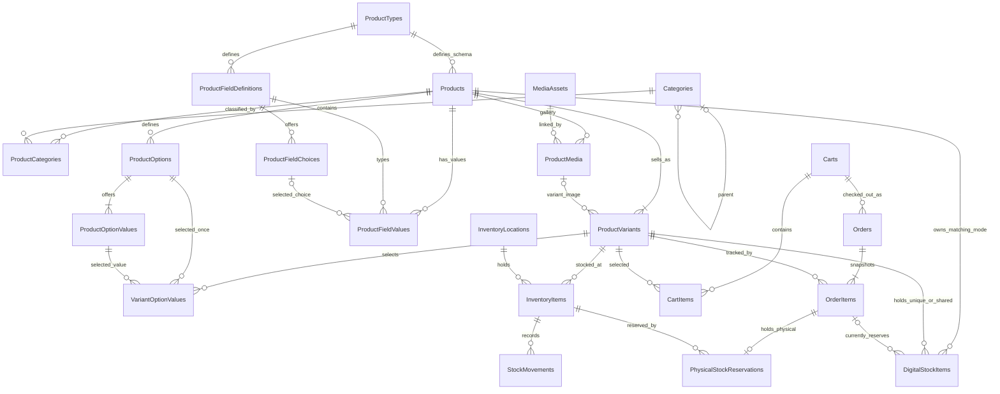

# Commerce database design

Status: Catalog/Inventory/Media/Outbox, digital stock management and [Cart/Order/reservation](features/ordering-checkout.md). Payments, delivery after payment and shipping execution belong to later slices. SQL Server and PostgreSQL share the logical model; migrations are provider-specific. One shop, whole VND amounts and one physical warehouse (`MAIN`); digital stock has a separate source. Verification and deployment status are recorded separately from implementation.

## Entity relationships

**Product–Category is N–N**, through `Catalog.ProductCategories`, never a `Products.CategoryId` column. A Product has exactly one ProductType and zero or more Categories. ProductType is a schema, Category is merchandising/navigation. There is no primary category. A Product must have at least one SKU; the domain enforces this minimum because a child-to-parent FK cannot enforce it.

Example: Product “Áo thun cổ tròn”, ProductType “Quần áo”, Categories “Áo nam” and “Hàng mới”, options Color/Size, SKUs Black–M/Black–L. Material/weight are custom product fields, separate from options that identify SKUs.

## Column dictionary

Unless listed as nullable (`?`), columns are required. `Guid` maps to `uniqueidentifier`/`uuid`; `DateTime` is UTC (`datetime2`/`timestamp with time zone`); `DateOnly` maps to `date`. Monetary columns are decimal(18,2), number field values decimal(18,4). Application-assigned entity IDs use the existing Guid generator.

Audited roots (Product, ProductType, Category, InventoryLocation, InventoryItem, MediaAsset, DigitalStockItem) include `Id`, `CreatedBy`, `CreatedOn`, `LastModifiedBy`, `LastModifiedOn?`, and a 32-character `Version` concurrency token. Actor identifiers are attribution, without a cascading FK to Identity. Commerce uses explicit statuses rather than generic soft deletion. Digital ProtectedContent is entirely excluded from audit values; secret reveals record a Read=4 trail with actor/item ID and no content.

| Table | Columns beyond common root fields | Keys and constraints |
|---|---|---|
| Catalog.ProductTypes | Code(100), NormalizedCode(100), Name(256), IsActive | UQ NormalizedCode; code immutable |
| Catalog.Products | ProductTypeId, Name(256), Slug(200), NormalizedSlug(200), Description(20000)?, Status, FulfillmentKind | FK ProductTypeId; UQ NormalizedSlug; alternate keys (Id,ProductTypeId) and (Id,FulfillmentKind); Status 1/2/3; Kind 1/2/3/4 default 1 |
| Catalog.Categories | ParentId?, Name(256), Slug(200), NormalizedSlug(200), Description(4000)?, SortOrder, IsActive | FK ParentId to Categories; UQ NormalizedSlug; ParentId != Id |
| Catalog.ProductCategories | ProductId, CategoryId | PK (ProductId,CategoryId); FK both roots; index (CategoryId,ProductId) |
| Catalog.ProductVariants | Id, ProductId, Sku(100), NormalizedSku(100), CombinationKey(700 ASCII), Price?, CompareAtPrice?, Currency(3), IsDefault, IsActive, ImageMediaId? | PK Id; UQ NormalizedSku; UQ (ProductId,CombinationKey); alternate key (ProductId,Id); filtered UQ ProductId WHERE IsDefault=true |
| Catalog.ProductOptions | Id, ProductId, Code(100), Name(100), SortOrder | PK Id; UQ (ProductId,Code); alternate key (ProductId,Id); FK ProductId |
| Catalog.ProductOptionValues | Id, OptionId, Code(100), Label(100), SortOrder | PK Id; UQ (OptionId,Code); alternate key (OptionId,Id); FK OptionId |
| Catalog.VariantOptionValues | ProductId, VariantId, OptionId, OptionValueId | PK (VariantId,OptionId); composite FKs described below |
| Catalog.ProductFieldDefinitions | Id, ProductTypeId, Code(100), DataType, Label(256), HelpText(1000)?, IsRequired, IsFilterable, IsActive, SortOrder | PK Id; UQ (ProductTypeId,Code); alternate key (Id,ProductTypeId,DataType); DataType 1..5 |
| Catalog.ProductFieldChoices | Id, FieldDefinitionId, Code(100), Label(256), IsActive, SortOrder | PK Id; UQ (FieldDefinitionId,Code); alternate key (FieldDefinitionId,Id) |
| Catalog.ProductFieldValues | ProductId, ProductTypeId, FieldDefinitionId, FieldType, TextValue(500)?, NumberValue?, BooleanValue?, DateValue?, ChoiceId? | PK (ProductId,FieldDefinitionId); typed-value check; composite FKs below |
| Catalog.ProductMedia | ProductId, MediaAssetId, SortOrder, AltText(500)? | PK (ProductId,MediaAssetId); FK both roots |
| Media.MediaAssets | StorageKey(300), ContentType(50), Size, State, ExpiresAt | UQ StorageKey; index (State,ExpiresAt); immutable keys |
| Inventory.InventoryLocations | Code(100), Name(256), IsActive | UQ Code; initialization creates MAIN explicitly |
| Inventory.InventoryItems | VariantId, LocationId, OnHand, Reserved (default 0) | UQ (VariantId,LocationId); AK (Id,VariantId); FK both roots; CHECK 0 <= Reserved <= OnHand; Available computed OnHand-Reserved |
| Inventory.StockMovements | Id, InventoryItemId, OperationId, Delta, QuantityAfter, Reason(1000), ActorId, CreatedAt | PK Id; UQ OperationId; FK InventoryItemId; CHECK Delta != 0 and QuantityAfter >= 0; index (InventoryItemId,CreatedAt,Id) |
| DigitalInventory.DigitalStockItems | ProductId, VariantId, FulfillmentKind, Reference(100 ASCII), ProtectedContent, State, ReservedForOrderItemId? | PK Id; UQ (VariantId,Reference); filtered UQ VariantId WHERE Kind=3; CHECK Kind IN (2,3); Available/Disabled require null reservation owner, Reserved requires Unique and nonnull owner; composite FKs below |
| Messaging.OutboxMessages | MessageId, Type(100), SchemaVersion, Payload, ActorId, CorrelationId(200)?, OccurredAt, State, Attempts, NextAttemptAt, LeaseToken?, LeaseUntil?, LastError(2000)? | PK MessageId; index (State,NextAttemptAt,LeaseUntil); operational rows have no soft delete/audit per lease |
| Catalog.CommerceLocks | Name(50), Version(32) | PK Name; stable migration-created categories/initialization lock rows |

### Composite foreign keys

- VariantOptionValues `(ProductId,VariantId)` → ProductVariants `(ProductId,Id)`.
- VariantOptionValues `(ProductId,OptionId)` → ProductOptions `(ProductId,Id)`.
- VariantOptionValues `(OptionId,OptionValueId)` → ProductOptionValues `(OptionId,Id)`.
- ProductFieldValues `(ProductId,ProductTypeId)` → Products `(Id,ProductTypeId)`.
- ProductFieldValues `(FieldDefinitionId,ProductTypeId,FieldType)` → ProductFieldDefinitions `(Id,ProductTypeId,DataType)`.
- ProductFieldValues `(FieldDefinitionId,ChoiceId)` → ProductFieldChoices `(FieldDefinitionId,Id)`.
- ProductVariants `(ProductId,ImageMediaId)` → ProductMedia `(ProductId,MediaAssetId)`; nullable ImageMediaId means no override image.
- DigitalStockItems `(ProductId,VariantId)` → ProductVariants `(ProductId,Id)` and `(ProductId,FulfillmentKind)` → Products `(Id,FulfillmentKind)`; both enforce the same Product/SKU/mode at the database boundary.
- DigitalStockItems `(ReservedForOrderItemId,VariantId)` → OrderItems `(Id,VariantId)` prevents reserving a code for a different SKU. Nullable owner means not currently reserved.

These enforce ownership at the database boundary, even if application validation is bypassed. They prevent values/options/images from being attached across unrelated products or schemas.

### Identity and SKU rules

Names can repeat; slugs are normalized lowercase ASCII and unique separately for Product and Category. SKU and type/option/field codes use normalized ASCII keys. Archived SKU codes remain reserved. CombinationKey is generated from sorted immutable option/value IDs; labels and display order never change SKU identity. Product defaults have a filtered index for *at most* one default; the domain requires *exactly* one active default.

A simple Product has one default SKU and no option selections. Each configurable SKU selects exactly one value for every axis. Defaults: maximum 3 axes, 200 SKUs; configuration allows at most 10 axes, fitting the persisted combination key. Option axes cannot change after SKU creation in v1; add values or rename existing labels instead. Default switches first clear the old flag within the same transaction to avoid an intermediate unique-index collision.

Price may be null while Draft. Price must be nonnegative whole VND; CompareAtPrice must be a larger whole VND amount when supplied. Publish requires prices on all active SKUs, an active ProductType, and all active required fields. Draft/Published/Archived are values 1/2/3. Stock does not change publication status.

### Typed custom fields and filtering

FieldType: 1 Text, 2 Number, 3 Boolean, 4 Date, 5 Choice. CHECK requires exactly one non-null value column matching FieldType. Missing row means missing value, distinct from false or zero. Values are product-level. Indexes `(FieldDefinitionId,typedValue,ProductId)` support SQL EXISTS filters. No JSON or arbitrary CLR paths are used for custom-field queries.

Operators: Text eq (case-sensitive binary comparison), Number/Date eq or inclusive range, Boolean eq, Choice in. All filters combine with AND. Only active filterable definitions and active choices accept filter requests. Product rows/count share predicates; stable Id ordering and maximum 100 rows/page. SKU price/option filters must match the same active SKU; out-of-stock means no matching active SKU has stock.

Field type/code and Product.ProductTypeId are immutable. Once a type has products, only optional fields may be added; required fields cannot be introduced retrospectively. Labels/help/filterability/activity/order can change. Inactive fields/choices retain existing data; new assignments are rejected. Reactivating a required field is blocked while a Published Product lacks its value. Type changes serialize with Product writes using a row lock.

## Transactions, history and deletion

All commerce FKs use Restrict/NoAction. There is no cascade from Product/Category/Variant/User into stock or historical data. Product/SKU APIs archive or deactivate, with no hard-delete/trash/restore endpoints. Category physical deletion requires zero children and zero product links. Category deactivation keeps relationships. Archive keeps galleries and stock history.

Every command owns a short database transaction and reloads its roots after acquiring locks. Schema → Product → Media lock order is consistent. Category topology edits serialize through a stable gate to prevent concurrent cycle creation. Product writes use Product.Version; schema writes use ProductType.Version; adjustments use InventoryItem.Version. Join/child changes advance the parent version and are audited. DB uniqueness/FK/check violations map to HTTP 409; stale versions also return 409.

An adjustment updates balance and appends one movement atomically. OperationId replay with the same target/delta/reason returns the original result; different content conflicts. Balance cannot drop below Reserved. Stock movements are append-only through the persistence pipeline; corrections are compensating entries. Adjustment now locks type → product → balance, matching checkout/release to avoid a product/balance deadlock. Reserving/releasing changes Reserved and version, not OnHand or StockMovement.

## Product fulfillment and digital stock

FulfillmentKind: Physical=1, DigitalUnique=2, DigitalShared=3, ManualExtension=4. The Product chooses one kind at creation, independently of ProductType/schema; all its SKUs inherit it. Kind is immutable in this slice. Existing Catalog rows migrate to Physical. Only Physical creates MAIN balances; physical adjustments reject SKUs with a digital/manual kind.

Unique has 0–N rows per SKU; each is one deliverable item. Shared has 0–1 row per SKU, enforced by the filtered unique index including Disabled rows. Shared always uses reference `SHARED`. References are immutable uppercase ASCII stock labels, unique within a SKU; they must not contain credentials. Unique content is immutable; Shared content may be replaced on the same row. No hard-delete/soft-delete endpoint; persistence rejects tracked hard deletes. Available=1/Disabled=2/Reserved=3; only Unique can be Reserved, with an owning OrderItem. Reserved items cannot be enabled/disabled through admin. Allocated/delivered ownership is not implemented yet.

Content input preserves its exact characters and is limited to 8000 UTF-8 bytes. ASP.NET Data Protection encrypts it with purpose `Boilerate.DigitalInventory.Content.v1` plus item ID; copying ciphertext to another ID cannot produce a valid reveal. ProtectedContent is nvarchar(max) in SQL Server and varchar(16000) in PostgreSQL; EF metadata/domain enforce a 16000-character maximum. No plaintext or ciphertext is returned in catalog/metadata/audit. Explicit reveal requires its own permission and commits an audit trail before returning.

Imports contain 1–100 rows and serialize with Product edits using the same type → product locks. Every digital write checks/touches Product.Version and commits stock plus metadata audit in one Unit of Work; responses include the resulting ProductVersion. Duplicate references or stale versions produce conflict; the entire batch rolls back. On a lost response, reload metadata; reusing references cannot append duplicate rows. This is version/identity conflict handling, not an Order allocation/idempotency implementation.

InStock reads the actual source: Physical OnHand > Reserved; Unique at least one Available item; Shared an Available shared item; ManualExtension accepts staff requests without a physical stock balance. An inactive SKU is unavailable. Search keeps price/options/stock predicates on the same active SKU. Published products may be out of stock; digital management does not publish drafts. Shared quantity multiplies SKU price at checkout without reserving multiple copies of its content; actual delivery/payment remain later use cases.

The database and the matching persistent Data Protection key ring are one recovery set. Key loss makes digital content unreadable; protect/backup the key volume and retain needed key material when rotating/restoring. See [runbook](operations-runbook.md).

## Media and durable delivery

State: Uploading=1, Ready=2, Deleting=3, Deleted=4. Persist upload intent before writing bytes; keys never overwrite/reuse another asset. Only JPEG/PNG up to 5 MiB, validated from actual bytes/signature. Expired uploads and unattached assets are eligible after 24 hours. Referenced assets, including archived products, are retained.

Attach/unlink/cleanup lock the same asset. Cleaner rechecks all ProductMedia references and marks Deleting before committing; only then deletes storage outside the transaction. Attach rejects Deleting/Deleted. Missing file is success; I/O/permissions failures retry. Deletion is idempotent after a crash between file deletion and DB acknowledgement.

Outbox rows commit with link changes and audit. V1 consumer is MediaCleanupRequested schema version 1. BackgroundService claims with atomic compare/update and a lease token, delivers at least once, retries with exponential backoff, and dead-letters after configurable attempts. Ack/retry updates require the current lease token. Replay is explicit, permission-protected and audited. Legacy generic in-process events are not serialized into this outbox.

Public media is served by asset ID only if linked to a Published Product; private files/avatars keep their authorization path. Public media sends no-store to recheck publication on every request. There is no Catalog cache in v1.

## Migration policy

InitialFoundation remains unchanged. CommerceCatalog is the second migration for each provider; its Up guard rejects nonempty legacy Product/Category tables, with no ETL/API compatibility implied. DigitalInventory is the third additive migration. OrderingCheckout is the fourth: adds Ordering tables, Reserved default 0, nullable digital owner, constraints and ordering gate without changing existing Catalog/digital content. Fresh installations apply all four; installations on this repo's baseline apply only pending migrations. OrderingCheckout Down rejects active physical/digital holds before any destructive DDL; even without holds it drops order history. Backup first. Never apply this baseline chain to an unrelated existing installation.

## Cart, orders and reservations

Full column/ownership dictionary and API decisions: [Ordering feature plan](features/ordering-checkout.md). Audited roots Cart, Order and PhysicalStockReservation have the existing Version(32) concurrency and actor attribution; their records cannot be hard-deleted through persistence. CartItems are replaceable links. OrderItems are immutable snapshots (tracked update/delete rejected) retaining name/SKU/options/kind/unit price/quantity and SKU ownership. Customer IDs are attribution without cascading Identity FKs. Order contact data is stored once on the order and excluded from audit JSON; cart/order responses contain no digital content or stock IDs.

Cart has exactly one customer, at most one cart/customer, and 0–50 distinct SKU lines with quantities 1..999. One Cart has 0–N Orders; each Order requires 1–50 OrderItems at the domain boundary. Each physical OrderItem has one reservation; UQ OrderItemId plus composite SKU FKs protects reservation ownership. The root InventoryItem tracks Reserved; the reservation records quantity and Held=1/Released=2 for history. Unique stock directly references its current reserving OrderItem. Shared/Extension do not reserve physical balances.

OrderStatus PendingPayment=1/AwaitingProcessing=2/Cancelled=3/Expired=4. Prepaid=1 has an expiry; CashOnDelivery=2 is limited to physical-only orders and has no payment TTL. No Paid/Delivered state or payment recording exists in this slice. Total/Subtotal/Shipping are whole decimal(18,2) VND; total equals subtotal plus server-configured shipping. Indexes enforce UQ order number and UQ(CustomerId,OperationId), and support customer history and pending expiry queries. RequestHash compares the normalized checkout payload so a replay returns the same order, including its current cancelled/expired state; changed payload conflicts.

Short transactions acquire CommerceLocks `ordering` first, then sorted schema/products, then sorted physical balances. The gate serializes Order/Cart writes and expiry workers for a normal small shop; it is a throughput tradeoff, not a distributed workflow engine. Checkout confirms cart version/current total and publication, reserves **all** lines, inserts snapshots/history and clears the cart together. Failure rolls back all those writes. Expiry/cancel releases held physical quantities and owned Unique rows once, and changes order status atomically. Checkout sweeps one bounded expiry batch before creating a new order; the worker drains remaining batches. Restart/two workers rely on persisted status/holds and the same gate. No service call happens inside these transactions.

Future tables: Order 1–N PaymentAttempt, PaymentAttempt 1–N Refund, Order 1–N Shipment, Shipment N–N OrderItem via ShipmentItem(quantity). These tables are not created by OrderingCheckout.
